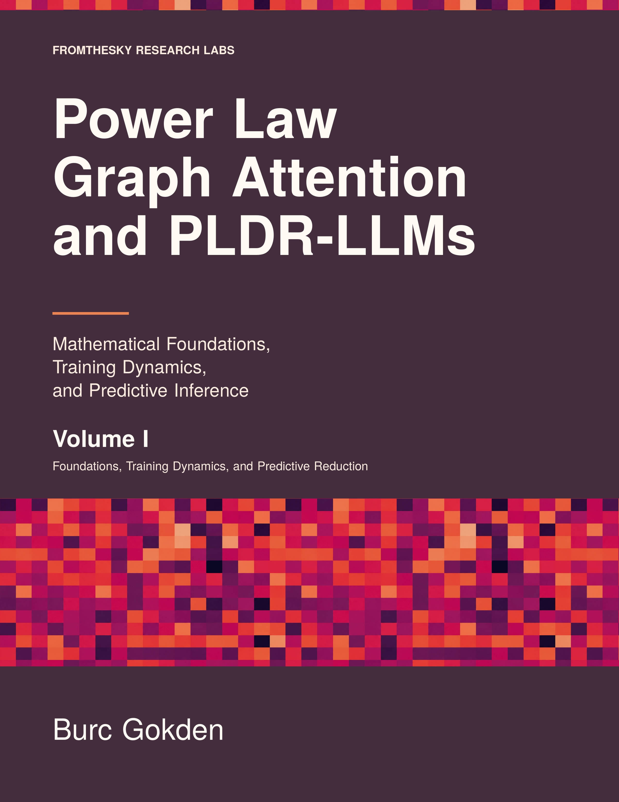
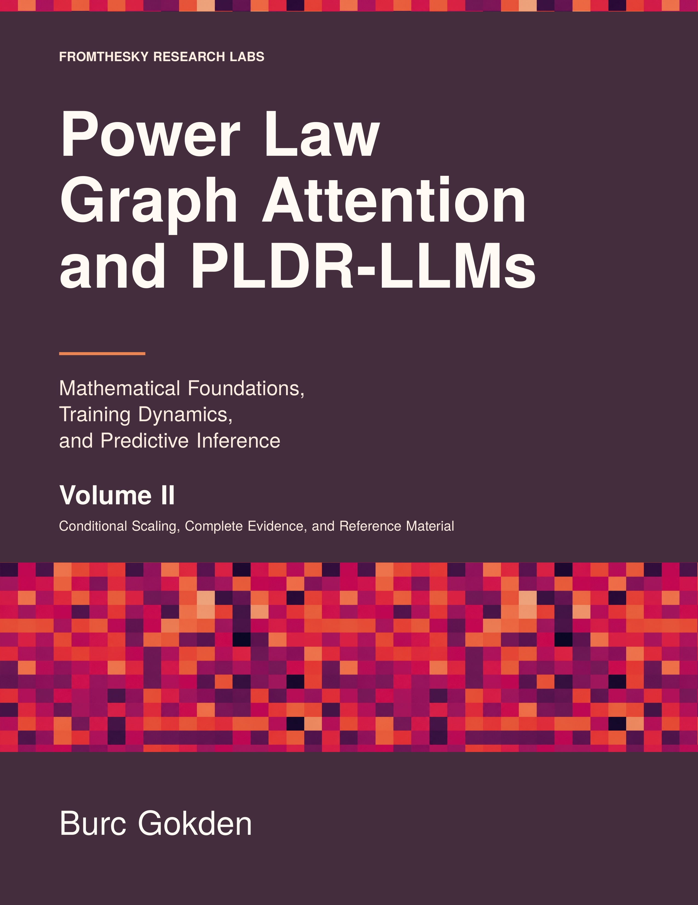

# Burc Gokden, PhD

**Principal & Founder · [Fromthesky Research Labs LLC](https://fromtheskyresearchlabs.com/)**

I combine semiconductor engineering and machine learning expertise to develop **AI/ML applications for TCAD, semiconductor manufacturing, and circuit-design workflows**. My background spans more than two decades of research and development across industry and academia, including process integration, physical verification, and device physics. I conduct **frontier AI research in language-model architectures, training dynamics, and inference**. I also develop **physical AI systems, factory AI applications, and commercial AI products across other sectors**, tailoring the approach to each project's needs.

I work across problem formulation, research direction, architecture, and implementation. My approach connects physical constraints and experimental evidence to models and software that engineers can inspect, evaluate, and use to make decisions.

[Website](https://fromtheskyresearchlabs.com/) · [Résumé](https://fromtheskyresearchlabs.com/gokden_resume.html) · [Google Scholar](https://scholar.google.com/citations?user=yovLHnwAAAAJ&hl=en) · [Models](https://huggingface.co/fromthesky) · [Writing](https://burcgokden.substack.com/) · [LinkedIn](https://www.linkedin.com/in/burcgokden) · [Email](mailto:burc@fromtheskyresearchlabs.com)

## Original AI research and books

I created **Large Language Models from Power Law Decoder Representations (PLDR-LLMs)** and the **Power Law Graph Transformer**. My research studies learned attention operators, training dynamics, and the conditions under which simpler inference computations preserve predictive behavior. It combines operator geometry, conditional probability, numerical experiments, and selected formal proofs in **Lean 4**.

- **Mathematical foundations:** [preprint](https://arxiv.org/abs/2608.10288) and [proofs, formalizations, and numerical audits](https://github.com/burcgokden/PLDR-LLM-Math-Foundations).
- **Training and predictive inference:** [preprint](https://arxiv.org/abs/2609.34130) and [research code](https://github.com/burcgokden/PLDR-LLM-Training-Dynamics).
- **Models and architectures:** [Hugging Face releases](https://huggingface.co/fromthesky), [PLDR-LLM inference implementations](https://github.com/burcgokden/PLDR-LLM-with-KVG-cache), and [Power Law Graph Transformer](https://github.com/burcgokden/Power-Law-Graph-Transformer).

I am the author of **Power Law Graph Attention and PLDR-LLMs: Mathematical Foundations, Training Dynamics, and Predictive Inference**.

| Volume I | Volume II |
| :---: | :---: |
|  |  |
| Foundations, Training Dynamics, and Predictive Reduction | Conditional Scaling, Complete Evidence, and Reference Material |

[**Explore and buy the two-volume series on Amazon**](https://www.amazon.com/dp/B0HMV7Q39J) · [Book companion](https://github.com/burcgokden/PLDR-LLM-Book-Companion) · [*Intelligence is Physical* on Substack](https://burcgokden.substack.com/)

## Semiconductor focus

I am pursuing projects and career opportunities in three connected areas:

- **TCAD and device modeling:** physics-guided surrogate models, simulation-to-measurement calibration, design-space exploration, and efficient selection of simulation runs and physical experiments.
- **Manufacturing and process development:** defect and yield analysis, process-window optimization, interpretable ML, design of experiments, and Bayesian optimization.
- **Circuit design and EDA:** simulation-driven design exploration, parasitic-aware tradeoffs, PDK knowledge assistants, physical verification, and agentic automation of engineering workflows.

## Industry and research experience

- **Siemens Digital Industries — Machine Learning Engineer.** Machine learning for semiconductor analysis.
- **Intel — process integration and physical verification software engineering.** Backend process development, nanoscale metal gapfill and interconnects, defect reduction, and EDA runsets for design-rule checking, latch-up reliability, and parasitic RC extraction at 7 nm and 10 nm nodes.
- **Harvard University and Northwestern University — semiconductor photonics.** Postdoctoral research at Harvard John A. Paulson School of Engineering and Applied Sciences; PhD in Electrical Engineering & Computer Science at Northwestern. Design, fabrication, and characterization of quantum cascade lasers, photonic crystals, and III–V photonic integration. My publications have received **1,000+ citations** overall; see [Google Scholar](https://scholar.google.com/citations?user=yovLHnwAAAAJ&hl=en) for the publication list and current citation count.

My EDA and analysis experience includes **ICV/PXL, StarRC, Calibre, KLayout, GDSII workflows, SQL, R/JMP, Tcl, and Perl**.

## Selected semiconductor AI projects

| Project | Engineering problem and implementation |
| --- | --- |
| [**DRCHealer**](https://github.com/burcgokden/DRCHealer) | Agent-driven design-rule verification and repair: KLayout execution, bounded geometric fixes, reverification, and an audit trail. |
| [**PDKScribe**](https://github.com/burcgokden/PDKScribe) | Hybrid retrieval over public PDK documentation, citation-backed answers, and structured ICV/PXL-style pseudocode for design-rule assistance. |
| [**FabDefectTriage**](https://github.com/burcgokden/FabDefectTriage) | Vision, historical-case retrieval, root-cause hypotheses, and confidence-based escalation in a synthetic wafer-map demo. |
| [**GroundedSHAP**](https://github.com/burcgokden/GroundedSHAP) | Feature-attribution analysis translated into grounded engineering reports and follow-up investigations. |
| [**SurfOptim**](https://github.com/burcgokden/SurfOptim) | Classical design of experiments, response-surface modeling, and Gaussian-process Bayesian optimization for selecting subsequent experiments. |

## Agentic AI, RAG, and model development

My hands-on proficiency spans the following tools and cloud services used across my public implementations:

| Capability | Tools and how I use them |
| --- | --- |
| **Agent orchestration and structured interfaces** | **LangGraph**, **LangChain Core**, **Pydantic**, and **FastAPI** for stateful workflows, typed outputs, validation, and human approval points. |
| **Retrieval-augmented generation (RAG)** | **LlamaIndex**, **Qdrant**, **Chroma**, **Sentence Transformers**, and **BM25** for document ingestion, hybrid retrieval, semantic search, and source grounding. |
| **Model training and inference** | **PyTorch**, **Hugging Face Transformers and Datasets**, **TensorFlow/Keras**, and **ONNX Runtime** for language-model development, training experiments, and vision inference; integrations with **vLLM**, **Ollama**, and **llama.cpp** for local LLM backends. |
| **Evaluation and experiment tracking** | **RAGAS**, **DSPy**, **Optuna**, and **MLflow** for RAG evaluation, prompt and parameter optimization, and experiment records. |
| **Scientific ML and optimization** | **NumPy**, **SciPy**, **statsmodels**, **scikit-learn**, **XGBoost**, **SHAP**, **pyDOE3**, and **Ax/BoTorch** for statistical modeling, interpretation, experimental design, and sequential optimization. |
| **Cloud applications** | **AWS:** SageMaker, Bedrock, Batch, Lambda, API Gateway, S3, and ECS/Fargate; **Google Cloud:** Vertex AI, Cloud Run, and Cloud Storage; **Azure:** Container Apps, Blob Storage, and managed identities. |

Cloud packaging and infrastructure code uses **Docker**, **Terraform**, **Azure Bicep**, and **AWS SAM** for container images and deployment definitions.

Supporting projects make these capabilities inspectable: [**HypothesisForge**](https://github.com/burcgokden/HypothesisForge) connects research hypotheses to bounded training experiments and metric-based critique; [**RagAnvil**](https://github.com/burcgokden/RagAnvil) evaluates and optimizes RAG pipelines. [**ClaimSynth**](https://github.com/burcgokden/ClaimSynth) and [**CiteScribe**](https://github.com/burcgokden/CiteScribe) support literature synthesis and citation-grounded research, while [**DocStringer**](https://github.com/burcgokden/DocStringer) applies AST-guided generation and structural checks to documentation workflows.

## Work with me

I welcome **consulting engagements, research partnerships, and career opportunities** with individual clients, founders, and institutional engineering and research teams. I am open to scientific and engineering challenges across industries, including **AI/ML applications in TCAD, manufacturing, and circuit design**, from research strategy and architecture through implementation and evaluation.

[Email me](mailto:burc@fromtheskyresearchlabs.com) or [contact Fromthesky Research Labs](https://fromtheskyresearchlabs.com/contact/) with the engineering problem, the constraints, and the outcome you want to achieve.
